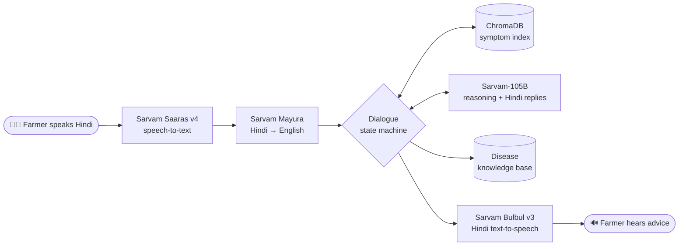

# FasalVachak (फसलवाचक)

**A Hindi voice helpline that diagnoses rice and cotton diseases over a call and tells the farmer what to do about them.**

A farmer describes what they see in their field, in their own words, in Hindi. FasalVachak works out which crop it is, asks one or two short follow-up questions to narrow down the disease, then speaks back practical treatment advice: dosages and products taken from a curated knowledge base, never invented. It is built entirely on **[Sarvam AI](https://www.sarvam.ai/)** models for speech, language and voice, with **[LiveKit](https://livekit.io/)** for real-time audio.

---

## Demo

A real session, recorded with the text test harness (`python test.py`). English glosses added for readers; long replies trimmed (…), otherwise unedited. The voice version speaks and hears exactly the same lines.

| | Hindi (what is said) | English gloss |
|---|---|---|
| 🤖 | नमस्ते, कृषिसेवा में आपका स्वागत है। आपकी धान या कपास की फसल में क्या लक्षण दिख रहे हैं, कृपया बताइए? | Welcome. What symptoms do you see in your rice or cotton crop? |
| 👨‍🌾 | मेरे धान के पत्तों पर आँख के आकार के धब्बे हैं, बीच में राख जैसा रंग और किनारे भूरे हैं | My rice leaves have eye-shaped spots, ash-coloured in the middle with brown edges. |
| 🤖 | क्या ये धब्बे पत्तों पर हैं या बालियों पर? | Are the spots on the leaves or on the panicles? |
| 👨‍🌾 | पत्तों पर हैं | On the leaves. |
| 🤖 | क्या धब्बों का आकार लंबा या अंडाकार है? | Are the spots elongated or oval? |
| 👨‍🌾 | बीच में राख जैसे हैं, किनारे भूरे | Ash-like in the middle, brown at the edges. |
| 🤖 | आपने जो लक्षण बताए हैं, उनसे ऐसा लगता है कि आपकी फसल में ब्लास्ट बीमारी हो सकती है। … बचाव के लिए खेत की मेड़ और नालियों में उगने वाले खरपतवार को हटाकर नष्ट करना बहुत जरूरी है। जब शुरुआती लक्षण दिखें तो आप मुख्य खेत में एडिफेनफोस 200 मिलीलीटर या कार्बोेंडाजिम 100 ग्राम प्रति एकड़ के हिसाब से छिड़काव कर सकते हैं। … क्या आपको Blast के बारे में और जानकारी चाहिए? | From your symptoms this looks like **Blast**. Remove weeds from bunds and channels. At first symptoms, spray Edifenphos 200 ml or Carbendazim 100 g per acre. Would you like more information? |
| 👨‍🌾 | हाँ | Yes. |
| 🤖 | जी ज़रूर, बताइए, आप क्या जानना चाहते हैं? | Sure, what would you like to know? |
| 👨‍🌾 | कौन सी दवाई का छिड़काव करूँ? | Which medicine should I spray? |
| 🤖 | जब शुरुआती लक्षण दिखें, तो आप मुख्य खेत में Edifenphos 200 ml, Carbendazim 100 g, Tricyclazole 75 WP @ 200 g, Iprobenphos 200 ml/acre, या Azoxystrobin + Difenoconazole 100 ml/acre का छिड़काव कर सकते हैं। … | At first symptoms, spray any one of: Edifenphos, Carbendazim, Tricyclazole, Iprobenphos, or Azoxystrobin + Difenoconazole (doses as listed). |
| 👨‍🌾 | नहीं, धन्यवाद | No, thank you. |
| 🤖 | ठीक है। कृषिसेवा में कॉल करने के लिए धन्यवाद। नमस्ते! | Thank you for calling. Goodbye! |

---

## How it works



Each call moves through four phases:

1. **Crop detection.** Is this rice (धान) or cotton (कपास)? If unclear, the agent asks. Everything the farmer says is kept, so symptoms mentioned before the crop are not lost.
2. **Diagnosis.** The farmer's description (translated to English) is embedded and matched against the symptom index, filtered to that crop. The top 3 candidate diseases go to Sarvam-105B, which either asks **one short yes/no-style question in Hindi** that best separates the candidates, or names the disease. After at most 2 questions it must decide.
3. **Treatment advice.** The diagnosed disease's knowledge-base record (symptoms, spread, favourable conditions, management) is given to the LLM, which explains it in about 90–130 words of spoken Hindi. It keeps product names and dosages exactly as written in the knowledge base and is told never to add facts that aren't there.
4. **Follow-up.** The farmer can ask up to 2 follow-up questions ("which other medicine?", "when do I spray?"), answered strictly from the knowledge base. If the answer isn't there, the agent says so and points them to their local Krishi Vigyan Kendra.

**Design choices worth noting**

- **Grounded, not generative, advice.** The LLM can only pick from retrieved candidates, and every dosage comes from the knowledge base. If the LLM names a disease outside the candidate list, it is mapped back onto a candidate rather than trusted.
- **Built for a phone call.** Short questions, no lists or markdown in spoken output, every fixed prompt written in Devanagari for the Hindi voice, and a hard cap on questions so calls stay short.
- **Latency-aware model use.** Sarvam-105B's hidden reasoning is turned off by default. With it on, a turn took 4–13 s and could use up the whole token budget; with it off, turns take about 1 s with comparable answers.

### Sarvam models used

| Job | Model | Where |
|---|---|---|
| Speech-to-text (streaming, Hindi) | `saaras:v4` | [`server.py`](server.py) |
| Hindi → English translation | `mayura:v1` | [`llm/translation.py`](llm/translation.py) |
| Crop check, treatment advice, follow-ups | `sarvam-105b-conversations` | [`llm/client.py`](llm/client.py) |
| Diagnosis questions and decision | `sarvam-105b` | [`llm/client.py`](llm/client.py) |
| Text-to-speech (Hindi voice) | `bulbul:v3`, speaker `ritu` | [`tts/sarvam_client.py`](tts/sarvam_client.py) |

Symptom search uses the open-source `all-MiniLM-L6-v2` embedding model running locally (Sarvam does not offer an embeddings API).

---

## Try it yourself

**Requirements:** Python 3.10+ (developed and tested on 3.12) and a [Sarvam API key](https://dashboard.sarvam.ai/). For the voice version you also need a free [LiveKit Cloud](https://cloud.livekit.io/) project.

### 1. Install

```bash
git clone https://github.com/TechABie10/FasalVachak.git
cd FasalVachak
python -m venv venv
venv\Scripts\activate          # Windows
# source venv/bin/activate     # macOS / Linux
pip install -r requirements.txt
```

### 2. Configure

Copy `.env.example` to `.env` and fill in your keys:

```bash
cp .env.example .env           # Windows: copy .env.example .env
```

```ini
SARVAM_API_KEY=your_sarvam_key          # required for everything
LIVEKIT_URL=wss://your-project.livekit.cloud   # voice only
LIVEKIT_API_KEY=...                     # voice only
LIVEKIT_API_SECRET=...                  # voice only
```

### 3a. Text test (quickest: only needs the Sarvam key)

```bash
python test.py
```

Type as the farmer, in Hindi (Devanagari) or Hinglish. The agent's replies and the current dialogue phase are printed after each turn. Try:

> मेरे धान के पत्तों पर आँख के आकार के धब्बे हैं, बीच में राख जैसा रंग और किनारे भूरे हैं

> कपास के पौधे मुरझा रहे हैं और पत्ते पीले होकर गिर रहे हैं

The first run downloads the small embedding model (~90 MB), which takes a moment.

### 3b. Voice test

1. Start the agent and wait for `registered worker` in the log:
   ```bash
   python server.py dev
   ```
2. Open the **[LiveKit Agents Playground](https://agents-playground.livekit.io/)**, sign in with the LiveKit account that owns your project, select it and click **Connect**. Allow microphone access.
3. You will hear the Hindi greeting. Speak your symptoms in Hindi, then pause for a second; each pause triggers a reply (about 3–5 s).

Tips: wear headphones so the agent doesn't hear itself, and wait for it to finish speaking before you reply (it can't be interrupted yet). The terminal logs what was heard (`[STT] Farmer said: ...`) and how it was translated, which helps when debugging.

---

## Knowledge base

22 diseases, each with symptoms, causal organism, survival and spread, favourable conditions and management (products and doses):

- **Rice (12):** Blast, Brown Spot (Sesame Leaf Spot), Bacterial Leaf Blight, Rice Tungro Disease, Sheath Rot, Sheath Blight, False Smut (Lakshmi Disease), Bacterial Leaf Streak, Bakanae Disease (Foot Rot), Rice Yellow Dwarf, Rice Grassy Stunt Disease, Grain Discolouration
- **Cotton (10):** Fusarium Wilt, Verticillium Wilt, Root Rot, Grey (Areolate) Mildew, Boll Rot, Alternaria Leaf Spot, Alternaria Leaf Blight, Cercospora Leaf Spot, Bacterial Blight, Tobacco Streak Virus

The records live in [`kb/rice.json`](kb/rice.json) and [`kb/cotton.json`](kb/cotton.json). A prebuilt symptom index is included in `rag/chroma_symptoms_db_raw/`. After editing the JSON files, rebuild it from the project root:

```bash
python -m rag.ingest
```

---

## Configuration

All optional except the keys above. Defaults shown.

| Variable | Default | Purpose |
|---|---|---|
| `TTS_ENABLED` | `true` | `false` prints replies instead of speaking them |
| `SARVAM_STT_MODEL` | `saaras:v4` | Speech-to-text model |
| `SARVAM_TRANSLATION_MODEL` | `mayura:v1` | Translation model (`sarvam-translate:v1` also works) |
| `SARVAM_FAST_MODEL` | `sarvam-105b-conversations` | Classification, advice and follow-ups |
| `SARVAM_REASONING_MODEL` | `sarvam-105b` | Diagnosis step |
| `SARVAM_REASONING_EFFORT` | `none` | `low` / `high` / `max` adds hidden reasoning (more latency) |
| `SARVAM_TTS_MODEL` | `bulbul:v3` | Text-to-speech model |
| `SARVAM_TTS_SPEAKER` | `ritu` | Bulbul v3 voice |
| `SARVAM_TTS_PACE` | `0.9` | Speaking speed |

---

## Project structure

```
server.py              LiveKit voice agent: audio in → STT → dialogue → TTS → audio out
test.py                Text-only test harness for the dialogue (no audio needed)
dialogue/session.py    Dialogue state machine: crop → diagnosis → advice → follow-up
llm/client.py          Sarvam chat-completion calls
llm/translation.py     Sarvam Hindi → English translation
llm/prompts.py         All LLM prompts
rag/retriever.py       Crop-filtered symptom search + knowledge-base lookup
rag/ingest.py          Builds the ChromaDB symptom index from the knowledge base
kb/                    Disease knowledge base (rice.json, cotton.json)
tts/sarvam_client.py   Sarvam Bulbul TTS, streamed into the LiveKit room
```

---

## Limitations and next steps

- **Two crops, 22 diseases.** Adding a crop means adding a JSON file and re-running the ingest.
- **No barge-in yet.** The farmer can't interrupt the agent mid-sentence.
- **Diagnosis is from described symptoms only.** It is phrased to the farmer as an assessment, not a lab-confirmed result. Photo-based diagnosis would be a natural addition.
- **Telephony.** It currently runs through a browser/WebRTC client; LiveKit SIP would put it on a real phone number for farmers without smartphones.

## Troubleshooting

| Symptom | Fix |
|---|---|
| `SARVAM_API_KEY is not set` | Add it to `.env` in the project root. |
| Error that collection `agri_symptoms` does not exist | Run `python -m rag.ingest` from the project root. |
| Voice: agent joins but never replies | Check the terminal for `[STT] Farmer said:` lines. If missing, check mic permissions in the browser. |
| Voice: no greeting heard | Make sure `TTS_ENABLED=true` and look for `[TTS]` errors in the log. |
